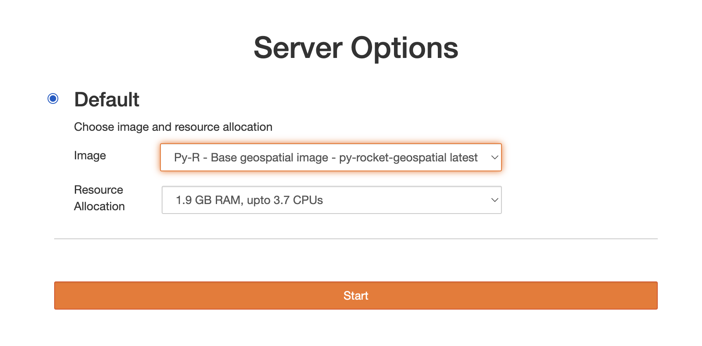
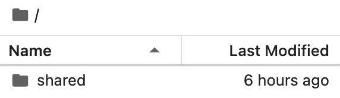

Everything in this tutorial runs on a JupyterHub in the cloud. You do not need
to install anything on your own computer.

::: {.callout-warning}
## The workshop hub is deleted a week after the hackathon
Everything on it goes: your home directory, the shared folders, and the scratch
bucket. Before then, push your work to GitHub
([Git and GitHub, with an agent](04-git-with-agent.qmd)), and download anything
else you want to keep.
:::

::: {.callout-note icon=false}
## You will

- Log in and start a server
- Save your work before the hub is deleted
- Know where your files live, and which folders are shared
- Stop or restart your server
:::

## Start a server

1. Go to []().
2. Log in. Your **username is your email address**. The **password** is the
   one the organizers give you at the start of the hackathon; everyone uses the
   same one. Do not post it anywhere public, including GitHub.
3. **Image:** keep the default, a geospatial image with Python and R.
4. **Size:** pick the smallest machine. That is plenty for everything here.
   Larger machines cost more, so choose one only if you run out of memory.

   {fig-alt="The machine size drop-down" width=70%}

5. Click **Start**. It can take a few minutes to start.

When it is ready you land in JupyterLab, on the **Launcher**. Next:
[Find your way around JupyterLab](02-jupyterlab.qmd).

## Your files

- **`/home/jovyan`** is your home directory. Everyone's home is called
  `/home/jovyan` (that is the Jupyter default), but yours is private, and it
  persists between sessions.
- **`shared/`** is read-only, with files the organizers have put there for you.
- **`shared-public/`** is read-write and visible to everyone. Make a team
  folder there. Agree with your team who edits what, because anyone can change
  anything in it.

{fig-alt="The shared folders in the file browser" width=50%}

## Stop your server

When you are done for the day, stop your server. It shuts down after 90 minutes
idle anyway, but a running server costs money. **Stopping does not delete your
work.** It is like turning off your computer.

From the **JupyterLab** tab, choose one of these:

- **File → Log Out**
- **File → Hub Control Panel → Stop My Server**

::: {.callout-tip}
Lost the JupyterLab tab? Go to []().
:::

## If the server crashes

This can happen when many people use a lot of memory at once. Go to **File →
Hub Control Panel**, click **Stop My Server**, then **Start My Server**. You
will not lose work, unless you were in the middle of uploading a file.

## Getting help

- Ask in the hackathon channel, or ask a helper in the room.
- Problem with this tutorial? Open an issue in
  [ocean-icechunks/2026-ioos-hackathon](https://github.com/ocean-icechunks/2026-ioos-hackathon/issues).

[Adapted from [NMFS HackDays 2025: Intro to JupyterHubs](https://nmfs-opensci.github.io/NMFSHackDays-2025/topics-skills/01-intro-to-jupyterhub.html).]{.small}
