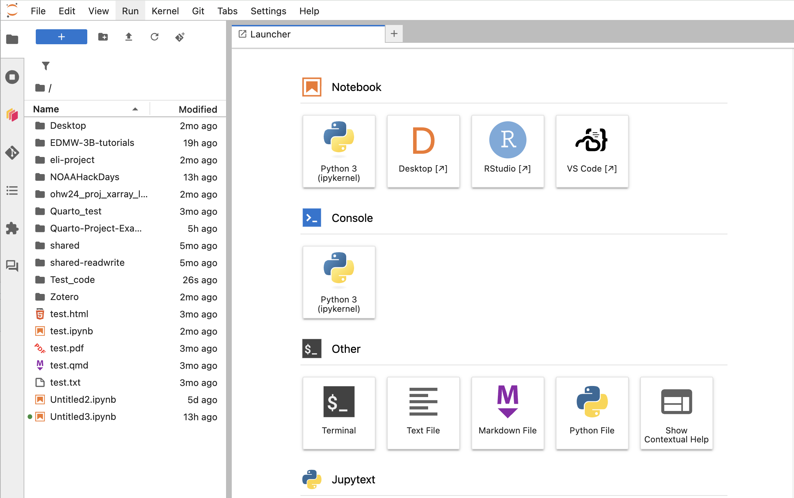

You need three things in JupyterLab for this hackathon. The **terminal** is
where your coding agent runs. The **file browser** shows what the agent
changed. **Notebooks** are where you run and check its work.

## The Launcher

The Launcher opens notebooks, terminals and files. If you do not see it, choose
**File → New Launcher**, or click the blue **+** at the top left.

{fig-alt="The JupyterLab Launcher" width=80%}

## The terminal

Click **Terminal** in the Launcher, or choose **File → New → Terminal**. This
is where you will start your agent. You only need a few commands yourself:

| Command | What it does |
|---|---|
| `pwd` | Shows which folder you are in |
| `ls` | Lists the files here (`ls -a` also shows hidden ones) |
| `cd folder` | Moves into a folder |
| `cd ..` | Moves up one folder |
| `cd ~` | Goes back to your home folder |

The agent will run most other commands for you, and it asks before it runs
anything risky. New to the shell? Try the
[Software Carpentry shell lesson](https://swcarpentry.github.io/shell-novice/).

## The file browser

The folder icon at the far left opens the file browser. Use it to move between
folders, make a new one (the folder icon with a **+**), and right-click a file
to rename or delete it. When an agent writes a file, it shows up here. Open it
and read it.

## Notebooks

Click **Python 3** in the Launcher to open a new notebook. A notebook is a list
of cells, and each cell is either code or Markdown.

- **Run a cell:** press **Shift + Enter**.
- **Run all cells:** use the **Run** menu.
- **Add a cell:** click the **+** in the notebook toolbar.
- **Change the cell type:** use the drop-down in the toolbar (Code / Markdown).

To open a notebook that someone else wrote, or that the agent wrote,
double-click it in the file browser.

## Installing packages

`%pip install package` in a notebook cell installs a package for the current
session only. It will be gone the next time your server starts. If something
should always be there, ask for it to be added to the hub image.

[Adapted from [NMFS HackDays 2025: Intro to JupyterLab](https://nmfs-opensci.github.io/NMFSHackDays-2025/topics-skills/02-intro-to-lab.html).]{.small}
