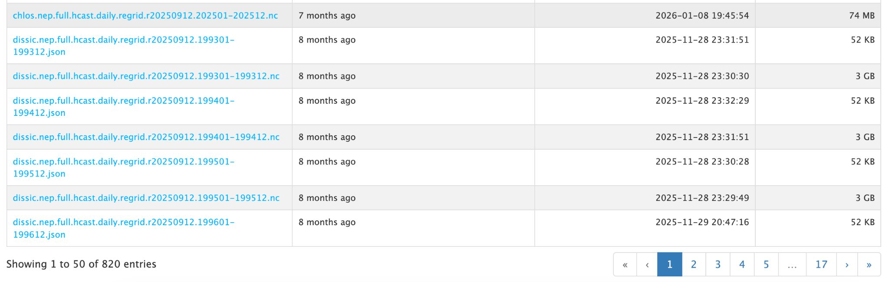
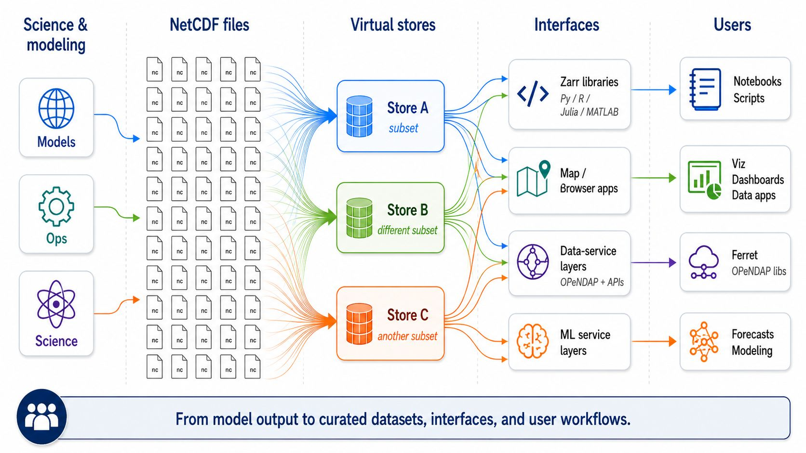
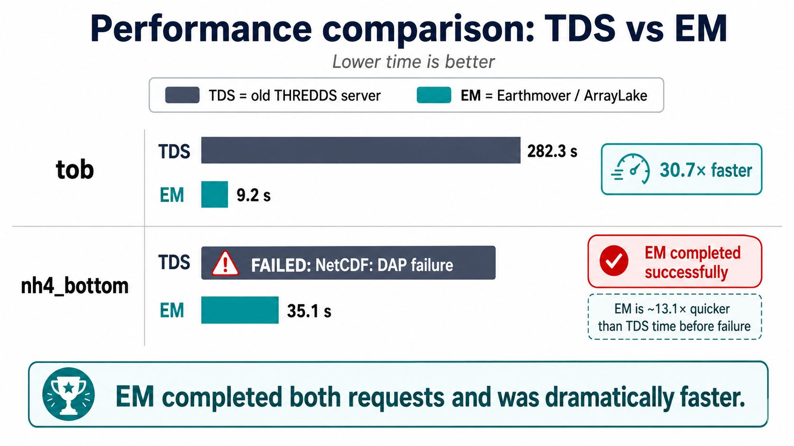
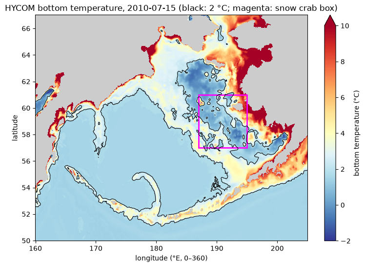
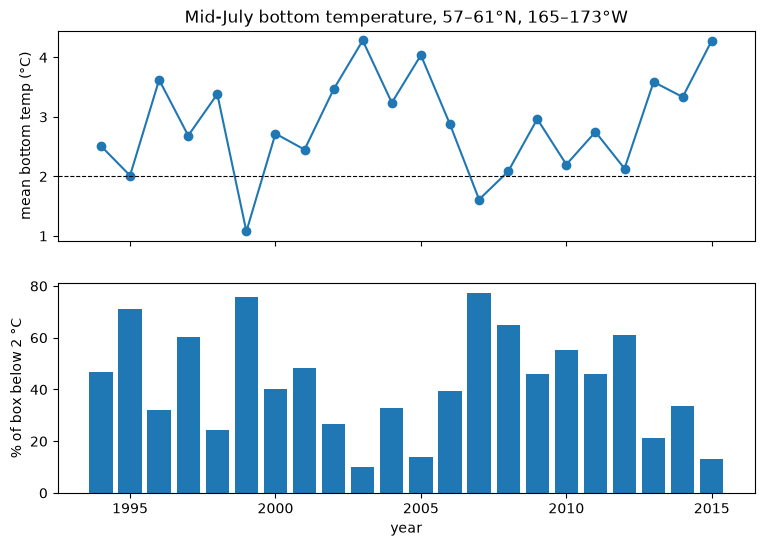

## So many NetCDF files

{fig-alt="A file listing showing NetCDF and JSON files named by variable and year, 'Showing 1 to 50 of 820 entries'"}

::: {.takeaway}
**820 files**, from one model, one hindcast, one region, and one release.
:::

::: notes
Ocean model output comes as thousands of NetCDF files, one per variable per
year (or per day). Which files do I need? Which variables? A time series means
opening hundreds of them.
:::

## Users want a product, not a pile of files {.visual}

{fig-alt="Diagram: models, ops and science write NetCDF files; virtual stores A, B and C each reference a subset; Zarr libraries, browser apps, OPeNDAP and ML services read the stores; notebooks, dashboards and forecasts use them"}

::: notes
A cloud-optimized dataset that is linked to the underlying files hides the file
structure. The user opens one dataset, with every variable and the full time
range, and never sees a file name. We deliver a product.
:::

## Why not just download the files, or use THREDDS?

::: {.columns}
::: {.column width="50%"}
**Downloading**

- Gigabytes to get the one slice you need
- Copies on every laptop, all out of date
- Hours of scripting before any science

**Data servers**

- Cap large requests (PSL THREDDS: 500 MB each)
- Fail under load ("NetCDF: DAP failure")
:::

::: {.column width="50%"}
**Object storage** (S3, Google Cloud, Azure)

- Serves byte ranges, not whole files
- Spreads requests across many machines, so
  parallel readers do not queue behind each other
- In practice, as many connections as you can
  throw at it
:::
:::

::: notes
THREDDS has one server, and every request goes through it. Object storage is
built to serve huge numbers of concurrent requests for pieces of objects. That
is what a cloud-optimized reader needs.
:::

## From minutes to seconds {.visual}

{height="620" fig-alt="Bar chart: tob took 282.3 s from THREDDS and 9.2 s from Arraylake, 30.7 times faster; nh4_bottom failed on THREDDS and took 35.1 s from Arraylake"}

::: {.refs}
Resampling a 2-D CEFI MOM6 NEP variable: THREDDS vs. a virtual store in Earthmover Arraylake. Holmes, ESIP, July 2026.
:::

# Let's see this in action

## Bering Sea snow crab, 1994–2015

[**306 TB** of HYCOM reanalysis · opens in **~1 s** · **nothing** downloaded]{.lead}

::: {.columns}
::: {.column width="50%"}
{height="430" fig-alt="Map of HYCOM bottom temperature in the Bering Sea on 15 July 2010, with the 2 degree C cold pool outlined and the snow crab box in magenta"}
:::
::: {.column width="50%"}
{height="430" fig-alt="Mid-July mean bottom temperature in the snow crab box and the percent of the box below 2 degrees C, each year 1994 to 2015"}
:::
:::

[**Open in Colab →**](https://colab.research.google.com/github/ocean-icechunks/hycom/blob/main/hycom-gofs-3pt1-reanalysis/bering-sea-snow-crab-demo.ipynb){.lead}

::: notes
Run all cells. The map is the cold pool on the eastern Bering Sea shelf. The
time series is the box-mean bottom temperature and the fraction of the box
below 2 °C. The metadata comes from Source Cooperative, and every value is read
by byte range from HYCOM's NetCDF files on AWS Open Data.
:::

## VirtualiZarr: no reprocessing

- **Keep the data as it is.** The NetCDF files stay where the provider put them.
- **Build a catalog of chunks.** For every chunk: which file, at what byte
  offset, and how long.
- **Save the catalog as one Zarr dataset.** Readers open that, and read the
  bytes straight from the original files.

::: {.takeaway}
If the files are compatible (the same grid, chunking and encoding), there is
nothing to rewrite.
:::

::: notes
This is the big change. We used to have to convert everything to Zarr, which
meant a second copy of petabytes. Virtual references point at the originals.
:::

## Why Icechunk, not Kerchunk?

Kerchunk made virtual datasets possible. Icechunk makes them safe to share and keep up to date.

- **Transactions.** Commits are atomic, with snapshots and rollback. Kerchunk
  references are plain JSON or Parquet files that anyone can overwrite.
- **Safe appends.** New files are added in a commit, and readers never see a
  half-written store. With Kerchunk you rewrite the references yourself.
- **Zarr-native.** The store is a real Zarr store, so any Zarr reader opens it.
  Kerchunk needs an extra fsspec reference layer.
- **Scale.** Chunk manifests are built for huge chunk counts. Very large JSON
  reference sets are slow to load.
- **Modern I/O.** The stack reads through Rust and obstore, not fsspec:
  more flexible (S3, GCS, Azure, local, HTTP) and fast under many
  concurrent requests.

::: notes
Kerchunk was the first way to get a virtual dataset, and it is still fine for a
quick one-off. The problems show up when a dataset is shared and grows: there
is no versioning, no atomic update, and no protection from two writers.

On I/O: Icechunk's Rust core uses the Rust object_store crate. obstore is the
Python binding to the same crate, and VirtualiZarr uses it to read NetCDF
metadata (the ObjectStoreRegistry in the notebook). Kerchunk goes through
fsspec. obstore's own benchmarks show large gains over fsspec for many
concurrent requests; say "in our experience" unless you have timed your own
case.
:::

## Handling forecast model run collections

A forecast model writes a new file every day. Keep every run, not just the latest.

- **Two time dimensions.** `time` is the forecast reference time, one value per
  file. `step` is the lead time, the same in every file. Data are
  `(time, step, ...)`.
- **Append along `time`.** Each new file adds one entry. Nothing is rewritten.
- **Valid time is computed.** It is `time + step`, never stored.
- **Pick a run, or a best estimate.** Select one forecast, or stitch the newest
  hours from every run into one continuous series.

::: {.takeaway}
One store holds the whole history of every forecast. Bonus lecture 7 builds one.
:::

::: notes
The raw files each have a single time dimension of valid times. If we simply
join them end to end, we throw away the older runs, and every update means
trimming and rewriting the tail. Splitting time into the reference time and
the lead time keeps every run, and a daily update is one append.

In the agent skill (building-fmrc-virtual-icechunk), the reshaping is done per
file before the concat: rename the time dimension to step, make the first valid
time the scalar reference time, then concatenate along time. All files must
have the same number of steps. Static variables (bathymetry, mesh connectivity)
must be kept out of the concat, or they get stacked once per run.

Best estimate is computed at read time, with Rolodex. Worked example: the
Taranto SHYFEM forecast store in the MAGICA school notebooks.
:::

## New tools make this much easier

- **VirtualiZarr 2:** reads NetCDF/HDF5 metadata and builds the chunk catalog
- **Icechunk 2:** stores the catalog, with versions and commits, like git for data
- **Coding agents + [ocean-icechunks-skills](https://github.com/ocean-icechunks/ocean-icechunks-skills):**
  plan, build, check and document a store for you

::: notes
A year ago this took a specialist days of trial and error. Now the libraries
handle the hard parts, and an agent with the skill knows the gotchas.
:::

# Let's try it out

## Make your own virtual store

::: {.stats}
[5]{.stat} NOAA NDVI NetCDF files on AWS

[303 MB]{.stat} of data, left in place

[54 kB]{.stat} Icechunk store
:::

[**Open in Colab →**](https://colab.research.google.com/github/ocean-icechunks/2026-ioos-hackathon/blob/main/notebooks/simple-virtual-icechunk.ipynb){.lead}

::: notes
Seven short steps: find the files, tell VirtualiZarr how to reach them, open
one, combine five, write and commit, reopen as a reader, plot real data.
Measured on 2026-11-13.
:::

## Resources

- **This tutorial:** [ocean-icechunks.github.io/2026-ioos-hackathon](https://ocean-icechunks.github.io/2026-ioos-hackathon)
- **Agent skills:** [ocean-icechunks/ocean-icechunks-skills](https://github.com/ocean-icechunks/ocean-icechunks-skills)
- **Example stores:** [ocean-icechunks/hycom](https://github.com/ocean-icechunks/hycom), [ocean-icechunks/icechunks](https://github.com/ocean-icechunks/icechunks)
- **Background:** [AI-ready scientific data archives](https://www.earthmover.io/blog/ai-ready-scientific-data-archives) (Earthmover, 2026)
- **Docs:** [VirtualiZarr](https://virtualizarr.readthedocs.io), [Icechunk](https://icechunk.io)

## Next: put an agent to work {.dark}

[Chapter 2 · Working with an agent](02-agent-and-skills.qmd){.lead}
