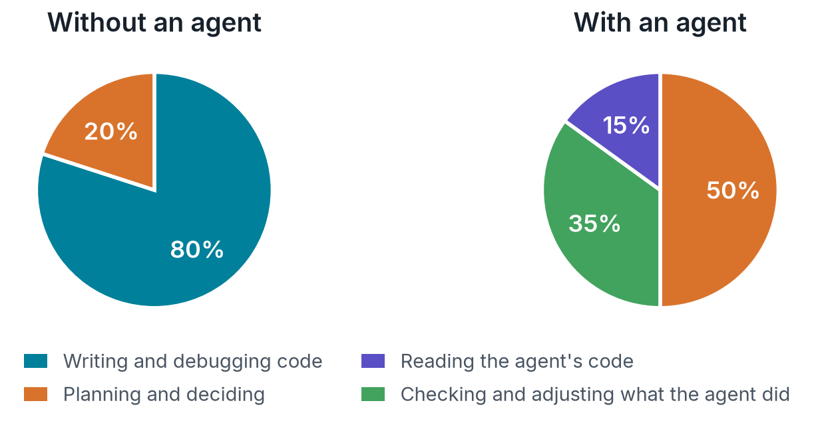

## From writing the code to directing the work {.visual}

{script="scripts/fig_agent_time.py" fig-alt="Two pie charts. Without an agent: 80% writing and debugging code, 20% defining the task and approach. With an agent: 50% defining the task and approach, 35% directing and refining the work, 15% reviewing code and text, and no time writing code."}

::: notes
My own rough estimate, not a measurement. Without an agent, 80% of my time
went to writing and debugging code. With one, I write almost none. Half my time
is defining the task and the approach; the rest is directing and refining the
work, and reviewing the code and text that come back.
:::

## An agent is not a chatbot

- It **reads your files, runs commands and writes code** in the folder you
  start it from
- It **asks before** it does anything risky. Read the request before you say yes
- It works **in your name**, with your subscription and your GitHub login

::: {.takeaway}
Treat it like a fast, well-read collaborator who is new to your project. Give
it clear tasks, and check its work.
:::

::: notes
Set up in the JupyterHub Skills pages: "Start your coding agent" installs
Claude Code, Codex or Antigravity and the ocean-icechunks skills.
:::

## One task, one session, one handoff

```{mermaid}
%%| fig-width: 11
%%{init: {"flowchart": {"htmlLabels": false, "padding": 14}, "themeVariables": {"fontSize": "20px", "fontFamily": "Inter, sans-serif"}}}%%
flowchart LR
  A["Pick a task"] --> B["Plan first"] --> C["Build small"]
  C -- "done?" --> E["Write a<br/>handoff note"] --> F["/clear"] --> A
```

::: notes
The biggest mistake is treating the agent like a chat: tangents and one
endless conversation. Every session gets one task with a boundary.
:::

## A task has a boundary

| A task | Not a task |
|---|---|
| "Check whether these HYCOM files allow byte-range reads" | "Help me with Icechunk" |
| "Write a plan for a virtual store of the NDVI files" | "Let's work on the data" |
| "Make the smoke-test notebook read real values" | "Make everything better" |
| "Explain why this store shows axes but no data" | "Tell me about Zarr" |

## Plan first, build small

- **Ask for a plan before any code.** Claude Code has a plan mode
  (**Shift+Tab**) that stops it from changing files while it plans
- **Read the plan.** That is where your science knowledge matters most
- **Build one small piece at a time:** one notebook, a few files, one check.
  Small pieces are easy to review, and cheap to redo

## Close the loop

When a task is done, or you are switching tasks, or the session is getting long:

1. *"I am about to clear. Write what we did and what's next to `notes/handoff.md`."*
2. Type `/clear`
3. Start the next task with *"Read `notes/handoff.md` and continue."*

::: {.takeaway}
Long conversations cost you three ways: they use up your subscription faster,
the agent loses focus, and a crash loses everything since the last note.
:::

# Skills

## What a skill is

- A **folder of instructions** (`SKILL.md` plus reference files) that teaches
  the agent how to do one kind of job
- The agent reads every installed skill's **one-paragraph description** at the
  start of a session
- When your request **matches**, it loads the skill and follows it

::: {.takeaway}
You do not call a skill. Describe the task in plain language, and the agent
picks the skill. To ask for one directly, type `/virtual-icechunk` (in Codex, `$virtual-icechunk`).
:::

## ocean-icechunks-skills

| Skill | Use it to |
|---|---|
| **virtual-icechunk** | Research, build, validate, document and audit virtual Icechunk stores of NetCDF/HDF5 files |
| **archive-to-cloud** | Copy a provider's files, unchanged, to object storage first, when they are not somewhere a store can reference |

Both were written from lessons learned on real ocean-data builds, and they
work with Claude Code, Codex, Copilot and Antigravity.

**Install them:** [Start your coding agent → Add the ocean-icechunks skills](../setup/03-start-your-agent.qmd#add-the-ocean-icechunks-skills)

[github.com/ocean-icechunks/ocean-icechunks-skills](https://github.com/ocean-icechunks/ocean-icechunks-skills){.small}

## The skill builds in a set order

```{mermaid}
%%| fig-width: 11
%%{init: {"flowchart": {"htmlLabels": false, "padding": 14}, "themeVariables": {"fontSize": "20px", "fontFamily": "Inter, sans-serif"}}}%%
flowchart LR
  A["1 · Research<br/>and plan"] --> B["2 · Smoke-test<br/>notebook"] --> C["3 · Production<br/>build"] --> D["4 · README and<br/>loading example"]
```

- **It stops for your review between steps.** Expect questions and a plan
  before any build code
- The smoke test writes to a **local** store and must read **real data** back
- Credentials never go in a notebook, and tests never touch a production store

## Prompts that work {.code}

```text
I want a virtual Icechunk store for the NOAA CDR NDVI files in
s3://noaa-cdr-ndvi-pds. Research the files and write a plan before any code.

Does this THREDDS server expose the real NetCDF files, or only OPeNDAP?

Write a smoke-test notebook that builds a small store from three of these
files and reads real data back.

The smoke test passed. Turn it into a production build script.

Write the README and a loading example for this store.

Why is this store so slow to open?
```

## You are still the scientist

- **Check the numbers.** Do the values, units and dates make sense for this
  dataset?
- **Ask why.** *"Why did you drop that variable?"* *"What did you assume about
  the time axis?"*
- **Stop it when it goes in circles.** A build that keeps failing gets more
  expensive, not more likely to work

## Report a lesson back

A skill only knows what someone has written into it. When a build teaches you
something:

1. Ask: *"What did this build teach that the virtual-icechunk skill should know?"*
2. Write it down in your project's notes, with the evidence
3. Open an [Update skill issue](https://github.com/ocean-icechunks/ocean-icechunks-skills/issues/new?template=update-skill.yml)

## Try it {.dark}

In a terminal on the hub:

```bash
mkdir -p ~/ndvi-store && cd ~/ndvi-store
claude          # or codex, or agy
```

Then ask: *"Research the NOAA CDR NDVI files for January 2000 in
s3://noaa-cdr-ndvi-pds and write a plan for a virtual Icechunk store. No code
yet."*

::: notes
Read the plan together. Does it find the files are NetCDF4/HDF5? That the
files are one day each? Does it notice the QA variable is unchunked? Chapter 4
covers what an audit should find.
:::

## Next: the basic pipeline {.dark}

[Chapter 3 · The basic pipeline](03-pipeline.qmd){.lead}
