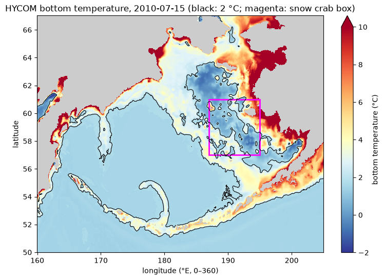

## Open a store in xarray {.code}

```python
import icechunk, xarray as xr

url = "https://data.source.coop/ocean-icechunks/hycom/hycom-gofs-3pt1-reanalysis"
repo = icechunk.Repository.open(icechunk.http_storage(url))

# The data live in HYCOM's bucket, outside the store: allow reads from there.
auth = {p: icechunk.credentials.HttpAccess for p in repo.config.virtual_chunk_containers}
repo = repo.reopen(authorize_virtual_chunk_access=auth)

ds = xr.open_zarr(repo.readonly_session(tag="v1").store, consolidated=False, chunks=None)
```

::: notes
From the snow crab notebook in chapter 1, which ran end to end on 2026-11-13.
Opening the 306 TB store takes about a second, because only metadata is read.
:::

## Then it is just xarray {.visual}

{fig-alt="Map of HYCOM bottom temperature in the Bering Sea on 15 July 2010, with the 2 degree C cold pool outlined and the snow crab box in magenta"}

## Icechunk is built on Zarr

- **Zarr** is an open format for chunked arrays in object storage. Each chunk is
  fetched on its own, with a simple web request
- **Icechunk** stores Zarr arrays, and adds versions and commits on top
- So any **Zarr reader with Icechunk support** can open these stores, in any
  language, straight from the bucket. No server in between

| Where | Libraries |
|---|---|
| **Python** | `icechunk` + `zarr` + `xarray`, as in this tutorial |
| **JavaScript** (browsers) | `zarrita` + `icechunk-js` |

## zarrita and icechunk-js

- **[zarrita](https://github.com/manzt/zarrita.js)** reads Zarr arrays in
  JavaScript: in a web page or in Node. It fetches only the chunks a view needs
- **[icechunk-js](https://github.com/EarthyScience/icechunk-js)** reads an
  Icechunk repository and hands it to zarrita as a store, including **virtual**
  chunks that live in the original NetCDF files

```typescript
const store = await IcechunkStore.open("https://data.source.coop/<account>/<store>");
const temp = await open(store.resolve("/water_temp"), { kind: "array" });
```

::: notes
Together they let a web page read a virtual store directly from object storage,
the same way xarray does in Python. That is what the viewer on the next slide
is built on.
:::

## gridlook: a store on a globe

**[gridlook](https://github.com/d70-t/gridlook)** is a WebGL viewer for Earth
system model output, built on zarrita and icechunk-js. Give it a store's URL,
and it draws the data on a globe in your browser, with nothing to install.

[**Open the ocean acidification indicators in gridlook →**](https://data.source.coop/ocean-icechunks/oa-indicators/viewer/index.html#icechunk+https://data.source.coop/ocean-icechunks/oa-indicators/climatology::varname=OmegaA_an::px=0::py=0::alt=95910936::lat=48::lon=-110::dimIndices_depth=0){.lead}

::: {.takeaway}
**Axes but no data?** The browser also needs CORS on the **source** host. NCEI
and the NDVI bucket send it; HYCOM's bucket on AWS does not.
:::

::: notes
The OA indicators store is virtual: metadata from Source Cooperative, data
from NCEI. Use the Depth slider to move through its 14 levels. The HYCOM viewer
shows axes but no data in an ordinary browser for this reason.
:::

## Bonus: find stores with STAC

If we have time and interest: with many stores, how do you find the ones that
cover your place and period? Describe each store as a **[STAC](https://stacspec.org)
item**, with its bounding box, time range and variables.

- **stac-geoparquet** holds all the items in one file
- **rustac** searches it by place and time
- **xpystac** opens a match in xarray

```python
hits = await rustac.search("ocean-icechunks-items.parquet",
                           bbox=[-158.5, 20.5, -157.5, 21.5],  # Oahu
                           datetime="2026-01-01/2026-02-01")   # 3 of 8 stores match
item = pystac.Item.from_dict(next(h for h in hits if h["id"] == "pacioos-roms_hiig"))
ds = xr.open_dataset(item.assets["data"], engine="stac")
```

[**Build the catalog, then search it →**](https://github.com/ocean-icechunks/2026-ioos-hackathon/blob/main/notebooks/stac-geoparquet-create.ipynb){.lead}

::: notes
Bonus material. The two notebooks are stac-geoparquet-create (walks the
ocean-icechunks bucket on Source Cooperative and writes one item per store to a
local geoparquet file) and stac-geoparquet-query (searches it and opens the
matches). Nothing is stored in the repository: everyone builds the catalog
themselves, which takes about a minute.

The search above was run on 2026-11-17 and returns noaa-ohc-np,
pacioos-roms_hiig and pacioos-ww3_hawaii. The ocean heat content stores keep
their data in groups (14day, 14day_v1, daily), and xpystac cannot open a group
yet, so the query notebook opens those by hand. It needs an xpystac newer than
release 0.5.0. Check that the workshop image has one before presenting this.
:::

## That's the tour {.dark}

- [Back to the start](../index.qmd), and the [Resources](../resources.qmd) page
- Build your own: open a terminal, start your agent, and ask it for a plan
