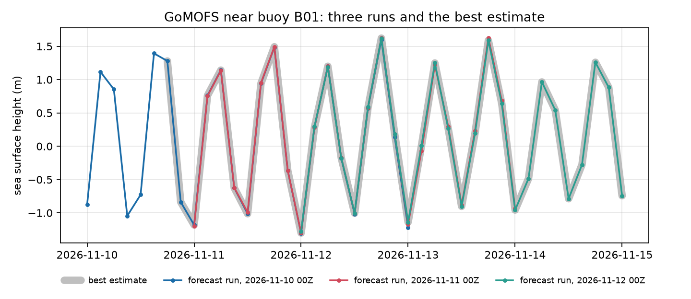

## A new run every few hours

If we have time and interest. Operational models write a new forecast **run** on
a schedule. Each file is a time series of *valid times*: when the model says
things will happen.

- Join the files end to end, and the **older runs are lost**. Every update means
  trimming and rewriting the tail
- But people ask for different things: the **latest** forecast, one **specific**
  run, or a **best estimate**, a continuous series that uses the newest run for
  every hour
- To answer all three, the store must keep **every run**

::: notes
This expands the slide in lecture 1. A run is also called a cycle, or a
forecast model run collection (FMRC) once you keep them all. The skill is
building-fmrc-virtual-icechunk in ocean-icechunks-skills.
:::

## Two time dimensions

| Dimension | Meaning | Values |
|---|---|---|
| `time` | **forecast reference time**: when the run started | one per run, **appended** |
| `step` | **lead time**: hours after the run started | the same in every run |

- Data variables are `(time, step, ...)`, with one chunk per run
- Valid time is `time + step`. It is computed when you read, **never stored**

::: {.takeaway}
Appending a new run adds one entry along `time`. Nothing already in the store is
rewritten.
:::

::: notes
Do not flatten this to a single valid-time dimension, with each new file
appended after the last. That is a different product, a best-estimate series. It
discards the older runs.
:::

## Our example: GoMOFS

::: {.stats}
[3]{.stat} runs: 10 to 12 November 2026, 00Z

[75]{.stat} NetCDF files, 55 GB, left in place

[401 kB]{.stat} Icechunk store
:::

NOAA's Gulf of Maine model runs four times a day. Each run is 25 files: the
nowcast valid at the run time, and a forecast every 3 hours out to 72 hours.

::: notes
Numbers from running the notebook on 2026-11-17. The files are NOAA's public
GoMOFS output (noaa-nos-ofs-pds). We use the 00Z run of three days, to keep the
notebook quick. The nowcast file n006 is valid at the run time, so it is lead 0.
:::

## 1 · One run becomes `(time, step)` {.code}

```python
# ds: the 25 files of one run, joined along the valid time (ocean_time)
ref = pd.Timestamp(cycle)                         # the run's reference time
valid = pd.DatetimeIndex(ds["ocean_time"].values)

ds = ds.rename_dims(ocean_time="step").drop_vars("ocean_time")
ds = ds.assign_coords(step=("step", (valid - ref).values))      # lead time

varying = [v for v in ds.data_vars if "step" in ds[v].dims]
static = ds.drop_vars(varying)                                  # grid, mask, ...
ds = xr.merge([ds[varying].expand_dims(time=[np.datetime64(ref)]), static],
              compat="override", combine_attrs="override")
```

::: notes
An excerpt of open_cycle in the notebook gomofs-fmrc-icechunk. The notebook
also checks that the valid times in the files agree with the times in the file
names, so the step axis cannot lie.
:::

## Where runs go wrong

- **Static variables.** Grid and mask variables, like `h` and `mask_rho`, have no
  time. Add `time` **only** to variables that vary with `step`. Otherwise every
  run stores its own copy of the grid
- **Time encoding.** Pin the units of `time` and `step`. Left to xarray, they
  depend on each run's own values, and a run appended later can decode to the
  wrong date
- **Same steps in every run.** `step` is one shared dimension. Check the lead
  times match before combining, with a clear error
- **Reference time from the file.** Use the file's own first time, not the date in
  its name. File names can be off by a day

::: notes
The first two are the ones people hit. A static variable stacked per run looks
fine until you notice the store is much larger than expected, and a wrongly
encoded append gives dates that are off with no error.
:::

## 2 · Create, then append {.code}

```python
def commit_cycle(repo, cycle, ds, append):
    session = repo.writable_session("main")
    if append:
        ds_time = ds.drop_vars([v for v in ds.variables if "time" not in ds[v].dims])
        ds_time.vz.to_icechunk(session.store, append_dim="time")
    else:
        ds.vz.to_icechunk(session.store)
    session.commit(f"GoMOFS cycle {cycle:%Y-%m-%d %Hz}")

commit_cycle(repo, first, one_cycle, append=False)     # create
commit_cycle(repo, second, open_cycle(second, cycles[second]), append=True)   # append
```

::: notes
One commit per run. An append carries only the variables that have a time
dimension, because writing the static variables again would rewrite their
metadata, which VirtualiZarr refuses. open_cycle takes a run's reference time and
its files: it is the reshaping on the previous slides, applied to the next run.
:::

## 3 · Daily updates: diff on reference time {.code}

```python
ds = xr.open_zarr(repo.readonly_session("main").store, consolidated=False, chunks={})

set_repo = set(pd.to_datetime(ds.time.values).strftime("%Y%m%d"))   # runs in the store
new = sorted(set_cloud - set_repo)                                  # only in the bucket
```

- Compare **reference times**, so a rerun never adds a run twice
- Append in increasing `time` order, so sort the new runs first

::: notes
set_cloud is the set of complete runs found in the bucket, keyed the same way,
as in section 1 of the notebook. If the bucket's folder dates differ from the
reference time, apply that offset in one place and comment on it. Run on the
store from the notebook with a fourth run in the bucket, it returns just the
fourth run.
:::

## 4 · Read it: best estimate with Rolodex {.code}

```python
import rolodex.forecast
from rolodex.forecast import BestEstimate, ForecastIndex

ds.coords["valid_time"] = rolodex.forecast.create_lazy_valid_time_variable(
    reference_time=ds.time, period=ds.step)                    # time + step
fmrc = ds.drop_indexes(["time", "step"]).set_xindex(
    ["time", "step", "valid_time"], ForecastIndex)

best = fmrc.sel(valid_time=BestEstimate(offset=6))   # newest run for every hour
```

::: notes
Rolodex (github.com/dcherian/rolodex) adds an xarray index. offset=6 starts each
run at step 6, which is 18 hours in with 3-hour steps, so the first hours of
every run, while the model settles, are skipped. The result has one dimension,
valid_time, and time and step say which run and lead each value came from. For
our three runs it has 35 valid times. The notebook pins Rolodex to commit
527bd42; main was the same commit on 2026-11-17.
:::

## Best estimate and the runs {.visual}

{fig-alt="Line plot of sea surface height in metres from 10 to 15 November 2026. Three colored forecast runs overlap a thick grey best-estimate line, and each newer run takes over from the one before it"}

::: notes
Same selection code as the Rolodex notebook, run on 2026-11-17, with the plot
redrawn for the slide so the runs show through. The blue run (10 November) is
used until 18:00 on 11 November, when the 11 November run takes over, and the
12 November run takes over a day later. The first 18 hours of the first run are
not in the best estimate, because of offset=6. The runs agree closely in this
window.
:::

## Try it

[**Build the store from NOAA's GoMOFS files →**](https://github.com/ocean-icechunks/2026-ioos-hackathon/blob/main/notebooks/gomofs-fmrc-icechunk.ipynb){.lead}

[**Read it with Rolodex →**](https://github.com/ocean-icechunks/2026-ioos-hackathon/blob/main/notebooks/gomofs-fmrc-rolodex.ipynb){.lead}

Run the second notebook on the same machine and in the same folder, because it
reads the store the first one writes. The first takes about four minutes.

## Back to the start {.dark}

- [Back to the start](../index.qmd), and the [Resources](../resources.qmd) page
- Next, if you have time: [finding stores with STAC](08-bonus-stac.qmd)
