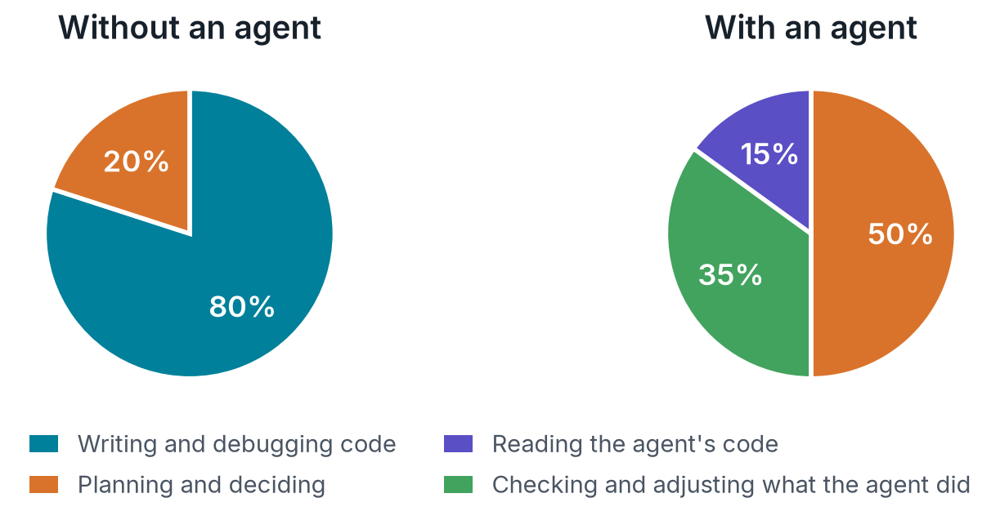

## Where my time goes now {.visual}

{script="scripts/fig_agent_time.py" fig-alt="Two pie charts. Without an agent: 80% writing and debugging code, 20% defining the task and approach. With an agent: 50% defining the task and approach, 35% directing and refining the work, 15% reviewing code and text, and no time writing code."}

::: notes
My rough estimate, not a measurement. The job shifts from typing code to
brainstorming, planning and directing. The rest of the talk is how I do that
part.
:::

# Handoff and notes

## The basic daily workflow: the handoff

1. *"What is the status? What is next for today?"*
2. Start work on this task
3. Bring the task to completion, or to a stopping point
4. *"Get ready to clear"*: write the handoff, then clear the context

::: {.refs}
[Anthropic, *Claude Code best practices*](https://www.anthropic.com/engineering/claude-code-best-practices)
· [Lopopolo, *Harness engineering* (OpenAI)](https://openai.com/index/harness-engineering/)
· [Bridgeford et al., *Ten Simple Rules for AI-Assisted Coding in Science*](https://arxiv.org/abs/2510.22254)
:::

## What is the handoff?

A short file in the repo, `agent/handoff.md`: **where things stand**.

:::: {.columns}
::: {.column width="50%"}
**What's in it**

- Repo state
- How we work here
- What shipped recently
- Open threads
- Pointers to the design notes
:::
::: {.column width="50%"}
**How the agent uses it**

- **Reads it first**, every new session
- Gets oriented, then **waits for my task**
- **Rewrites it** before I clear
- Commits it, so the **next session, another agent, or a collaborator** picks
  up from there
:::
::::

::: notes
Keep it lean: orientation, not a task list and not a diary. Detail goes in
the design notes; the handoff points to them. A fresh session reads a
one-page handoff in seconds instead of me re-explaining the project.
:::

## What is AGENTS.md?

The repo's **standing instructions** for any agent: read at every session start.

:::: {.columns}
::: {.column width="50%"}
**What's usually in it**

- What the repo is
- How to build and test
- Conventions and rules
:::
::: {.column width="50%"}
**How mine differ**

- **Only this repo's rules.** My general norms live in one config repo
  for all projects
- **Short:** a map that points to the handoff and design notes
- **Vendor-neutral**, written for people and agents
:::
::::

::: {.takeaway}
`CLAUDE.md` is one line, `@AGENTS.md`. Claude Code reads only `CLAUDE.md`;
other agents read `AGENTS.md`. One source, no copies to drift apart.
:::

::: notes
Why not a symlink: on a Windows clone or a zip download a symlink becomes a
text file containing the word "AGENTS.md", and Claude silently gets no
instructions. The first line of my AGENTS.md says "edit AGENTS.md, not
CLAUDE.md". Example from this repo: the layout, "run quarto render before
every commit", never write the hub password.
:::

## What are the design docs in a repo?

Markdown notes in `docs/design/`: **the decisions, and why, with the
evidence**.

:::: {.columns}
::: {.column width="50%"}
**What's in them**

- The plan, written before the code
- How the code is structured
- Decisions, with who and when
- Things that look wrong but are deliberate
:::
::: {.column width="50%"}
**Why I do this**

- **Planning:** we agree on the design before any code
- **Intentional structure,** not something an agent vibe-coded
- **Anyone, agent or human, can see the choices** and the reasons behind them
- **Reproducible and understandable** by agents and people
:::
::::

::: notes
They live under docs/ because they are documentation people read too: a
README or a code comment can link to them. The agent writes most of them; I
read and correct them, because that is where the decisions are.
:::

## How I do it: every repo carries its own notes

```text
AGENTS.md              how to work in this repo
agent/handoff.md       where things stand: read this first
docs/design/*.md       decisions, and why, with the evidence
memory/                one fact per file, shared by my agents
```

- A hook **loads the handoff** when a session starts
- **"I am about to clear"** → the agent updates handoff and memory, commits,
  pushes, says *Ready to clear*

::: notes
This goes further than the guidance: the notes are committed, so they travel
with the repo and a reviewer (person or agent) can check the work against the
intent. Generic names, not one vendor's: I use two agents.
:::

## In practice

- **Day 2** of xpublish-erddap: "Move session notes and handoff into this
  repo"
- **14 small "Handoff:" PRs** in one month, one after each chunk of work
- Decisions carry **a name and a date**: *"EH decided this on 2026-10-14 and
  asked for it to be written here because she will forget."*
- PacIOOS ends with a guide **for the data owner**: how each step runs, and
  what looks wrong but is deliberate

::: notes
Sources: xpublish-erddap commit b7b35f9 and PRs #23–#128; its handoff;
pacioos `how_store_created.md`.
:::

# Ten Simple Rules

## Ten Simple Rules for AI-assisted coding in science

:::: {.columns}
::: {.column width="50%"}
1. Learn the domain first
2. Frame the problem apart from the code
3. Pick how you work with the AI
4. Think through a solution first
5. Manage context
:::
::: {.column width="50%"}
6. Tests first
7. Let AI help plan tests
8. Watch progress; restart when stuck
9. Review the code critically
10. Small, focused steps
:::
::::

::: {.refs}
Bridgeford, Campbell, Chen, Lin, Ritz, Vandekerckhove and Poldrack,
arXiv 2510.22254 (2025)
:::

## How my rules and skills build them in

| Rule | In my setup |
|---|---|
| 1 · 4 Domain, solution first | A research note before any code; skills bring the domain knowledge |
| 2 Framing apart | Issues and design notes; I decide, the agent drafts options |
| 5 · 8 Context, restart | Handoff, memory, one task per session, `/clear` |
| 6 · 7 Tests | "Done when" on every issue; tests against the real thing; clean venv |
| 10 Small steps | One issue, one branch, one PR |
| Sandbox, approvals | Hooks block destructive git and pushes to `main` |

::: {.takeaway}
Eight of ten match. I differ on 3 and 9: I stay close to the decisions and
the evidence, not to every line of code.
:::

## In practice: xpublish-erddap, prototype to PyPI in a month

- **Scope in my words:** *"not an ERDDAP-like UI; make erddapy and rerddap
  code work"*
- **Day one:** a prototype, and issues #1–#12 filed the same day
- **An audit, not a fix:** "Audit the repository and propose work. Do not fix
  anything" (#50) → 18 issues → one PR each
- **Tested against the real thing:** 478 of 974 tests replay 239 responses
  from 10 real ERDDAP servers

::: {.stats}
236 commits · ~129 issues and PRs · 1 month
:::

::: notes
2026-09-15 to 10-14, work on 9 days. Ended with PyPI 0.1.0 and a transfer
to xpublish-community.
:::

# Reviewing without reading every line

## I don't read all the code. Honestly, neither do you.

- I don't read my operating system either. I trust it because of its
  **design, tests and track record**
- Skimming an agent's diff, you **glaze over**, and you pull it toward code
  that looks familiar
- For agent code, **you supply the design, tests and record yourself**

::: {.takeaway}
Understand the design and the evidence everywhere. Read the code where the
science or the risk lives.
:::

::: notes
Where reading pays: the calculation, units, missing-data handling; auth,
deletes, overwrites. PacIOOS #9, a script that could overwrite finished
copies, was found by reading while writing a skill.
:::

## 1 · Design notes are a must

- Talk through the design **before** the code
- Written for **agents and people**: the next session reads them, so does
  your collaborator
- "Agents write code I can't understand." *Did you have it write down the
  design first?*

## 2 · Know what is in the PR

- Ask the agent to **summarise the PR**: intent, what was run, what was not
- **Ask it questions.** *Why this structure? What did you assume? What would
  break this?*
- In Anthropic's study, people who asked **conceptual questions** understood
  the code best

::: {.refs}
Shen and Tamkin, *How AI assistance impacts the formation of coding skills*,
arXiv 2601.20245 (2026)
:::

## 3 · Break the work into tasks and phases

- Each issue: **Order N of M**, what it depends on, and **"Done when:"**
- One issue → one branch → one PR
- Small issues can run in parallel, one agent each

::: {.takeaway}
Big chunks of unstructured work are how you end up not knowing what the
agent did.
:::

## 4 · Clean up after every task

- **Handoff, then `/clear`.** A fresh session with good notes beats a long
  one that has forgotten the start
- My routine phrases: *"I am about to clear"*, *"This task is done"* (open the
  PR, then stop), *"I am about to sign off"*

# Security

## How I approach security

- **Sandbox:** agents run on a cloud VM, not my laptop; no `sudo`
- **All work in PRs.** Nothing goes straight to `main`
- **Production or sensitive work:** the PR is reviewed by an agent **and** a
  person
- **Control GitHub access:** fine-grained tokens, scoped to the repos the
  work needs
- **Let the agent keep you honest about credentials.** Giving it the keys to
  everything is easier. Don't.

[Safe agent practices](https://ocean-icechunks.github.io/2026-ioos-hackathon/agent-skills/01-safe-agent-practices.html){.lead}

## Thank you {.dark .closing}

- This tutorial: [ocean-icechunks.github.io/2026-ioos-hackathon](https://ocean-icechunks.github.io/2026-ioos-hackathon)
- Skills: [github.com/ocean-icechunks/ocean-icechunks-skills](https://github.com/ocean-icechunks/ocean-icechunks-skills)
- Example: [xpublish-erddap](https://github.com/xpublish-community/xpublish-erddap)
